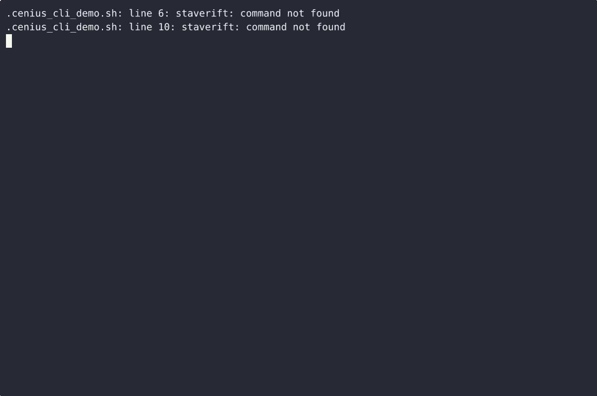

# StaveRift — complete Full-stack app command-line tool example app

**StaveRift** is Apache-2.0-licensed and fully open-source: a command-line tool written in Full-stack app that you can run, modify, and ship commercially without restrictions. StaveRift is a single-file, standard-library-only Python command-line tool for a working cooper: it keeps typed coopering jobs (barrel, cask, firkin, tun) with their stave geometry, computes the barrel outer diameter…. Grab StaveRift from this repo and self-host it, or [remix it on cenius.ai](https://cenius.ai/marketplace/p/staverift?ref=gh&utm_campaign=staverift-webapp) — the platform grants full rebrand rights on every change.


[](LICENSE)  [](https://cenius.ai)

[](https://cenius.ai/marketplace/p/staverift?ref=gh&utm_campaign=staverift-webapp)

> **▶ [Open & edit in cenius.ai](https://cenius.ai/marketplace/p/staverift?ref=gh&utm_campaign=staverift-webapp)** — one click to an editable workspace: describe changes in plain English, get an instant preview, one-click deploy and host. Modifications made on the platform come with full rebrand & relicense rights.

_Local clone? See [Quick start](#quick-start) below. cenius.ai is the zero-setup path._

## Demo


▶ **[Full demo walkthrough](https://cenius.ai/marketplace/p/staverift?ref=gh&utm_campaign=staverift-webapp)** — watch it on the project page · [download MP4](.github/media/demo.mp4)

## Screenshots



## Architecture

The repository contains 22 files of Full-stack app source, organised under `demo/`, `tests/`. One command (`./install.sh`) covers dependency setup and demo-data seeding. Full setup details: [`INSTALL.md`](INSTALL.md).

## Features

- Typed coopering jobs
- Stave diameter calculator
- Clamp time log
- Local JSON store
- Scriptable output and filters

## Quick start

```bash
./install.sh   # installs dependencies + seeds demo data
```

See [`INSTALL.md`](INSTALL.md) for full setup and usage instructions.

## Usage guide

Every command, with the real output it produces. Examples use a scratch store so
they are safe to paste; drop `--store /tmp/shop.json` to work on your real log.

### 1. Create a job

```bash
$ staverift --store /tmp/shop.json jobs create --type barrel --staves 30 --width 90
9c1e4b7a2f0d4e8fa1b2c3d4e5f60718
```

stdout is the new job id and nothing else, so it feeds straight into the next
command. The type must be one of `barrel`, `cask`, `firkin`, `tun`:

```bash
$ staverift jobs create --type foo --staves 30 --width 90
invalid --type 'foo'; allowed: barrel, cask, firkin, tun
$ echo $?
2
```

Each bad flag gets its own line, and the store is left untouched:

```bash
$ staverift jobs create --type cask --staves 2 --width 0
invalid --staves '2'; must be an integer >= 3
invalid --width '0'; must be a number > 0
```

### 2. Check the stave set geometry

```bash
$ staverift calc --staves 30 --width 90
diameter = width / sin(pi / staves); circumference = pi * diameter
FIELD               VALUE
─────────────  ──────────
staves                 30
width            90.00 mm
diameter        861.01 mm
circumference  2704.94 mm
```

`diameter = width / sin(pi / staves)`, `circumference = pi * diameter`. Both are
rounded to two decimals and echoed next to the inputs you supplied, so a
screenshot or a pasted line is self-documenting. `calc` never reads the store.

### 3. Time a clamp

Open a session (band required, integer >= 1), then close it:

_Full guide: [`USAGE.md`](USAGE.md)_

## FAQ

### What does it take to self-host StaveRift?

It runs entirely on your own machine. Clone, run `./install.sh`, and follow [`INSTALL.md`](INSTALL.md) — the whole stack is in this repo, no external dependencies required.

### Can I rebrand or white-label StaveRift?

Yes — and the easiest way is [remixing it on cenius.ai](https://cenius.ai/marketplace/p/staverift?ref=gh&utm_campaign=staverift-webapp): modifications made on the platform come with full rebrand and relicense rights over your derivative.

### Is StaveRift free for commercial use?

Yes. The code is Apache-2.0-licensed — use it, modify it, and ship it commercially. See [LICENSE](LICENSE).

### How is StaveRift built technically?

Powered by Full-stack app. This repo is the real thing — full source, seed data, and all — ready to clone and start up. Highlights include clamp time log.

### Is there a no-code way to modify StaveRift?

Non-developers can use [cenius.ai](https://cenius.ai/marketplace/p/staverift?ref=gh&utm_campaign=staverift-webapp) to make changes. Describe your goal in everyday language and the platform delivers an updated, ready-to-run project — zero coding on your part.

## License & rebranding

Released under the [Apache License 2.0](LICENSE) (© 2026 Cenius AI) — free for personal and commercial use. The Cenius name/logo are trademarks (see NOTICE).

**Need a customized version?** [Remix this app on cenius.ai](https://cenius.ai/marketplace/p/staverift?ref=gh&utm_campaign=staverift-webapp) — modifications made on the platform come with **full rebrand & relicense rights** over your derivative.

## Built with cenius.ai

This entire application — code, design, seeded demo data — was generated on **[cenius.ai](https://cenius.ai)** from a plain-English description.

- 🚀 [Build your own app on cenius.ai](https://cenius.ai)
- 🎛️ [Remix StaveRift on the marketplace](https://cenius.ai/marketplace/p/staverift?ref=gh&utm_campaign=staverift-webapp) — open it in a workspace, prompt for changes, and ship your own version.

More open-source apps: [the Cenius-ai catalog](https://github.com/Cenius-ai) · [showcase index](https://github.com/Cenius-ai/showcase)
